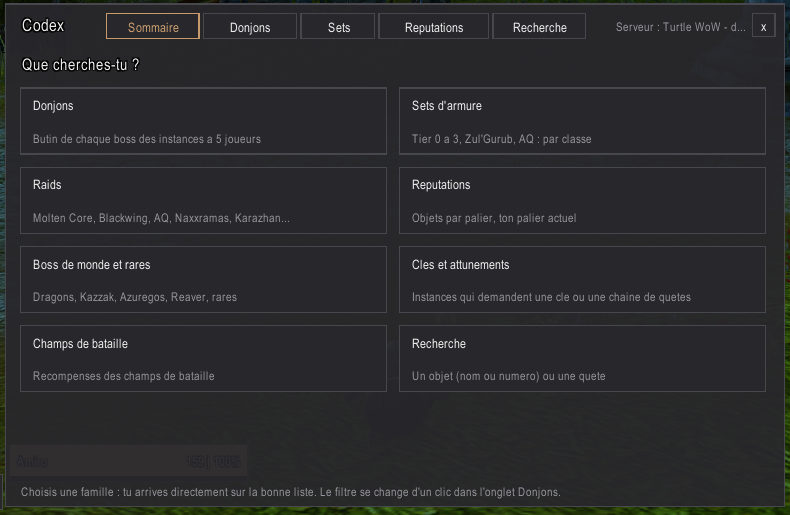
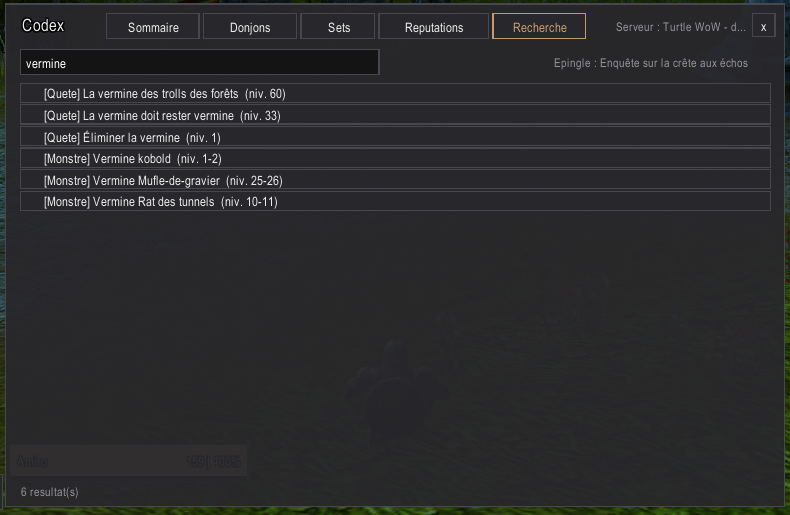
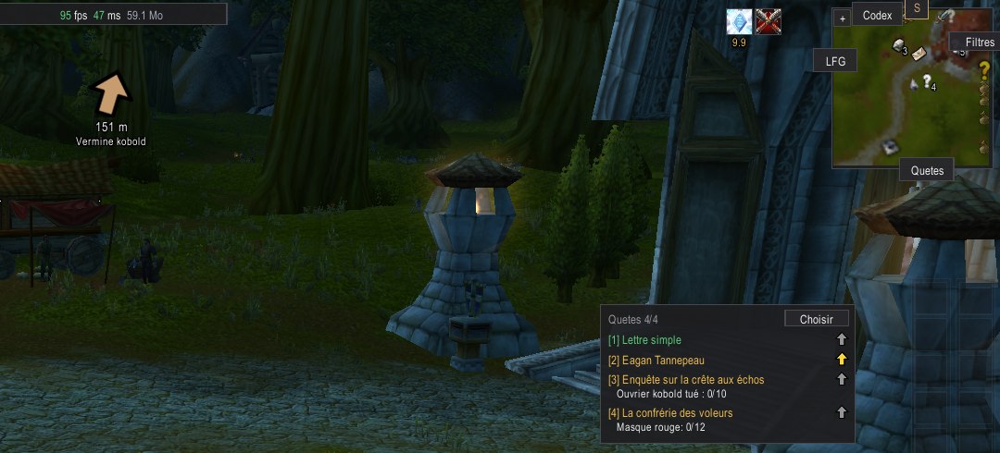
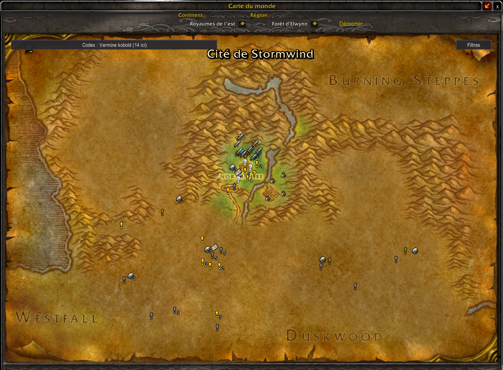

# ShikiUI

**Une suite d'interface complete pour WoW 1.12 (Turtle WoW / OctoWoW), ecrite de zero** — et les paquets de donnees facultatifs qui alimentent son Codex et ses outils de quetes.

[English](README.md) · Francais

ShikiUI, c'est **un addon plus quatre addons de donnees generes**, livres ensemble dans un seul zip. L'interface fonctionne seule ; les paquets de donnees
debloquent le **Codex** (butin des donjons, sets, reputations, quetes, monstres) et les **outils de quetes** (epingles de carte et de minicarte, fleche de direction).
Bilingue **FR/EN** natif (client francais ou anglais), styles thematises, menu Simple/Expert, mode Raid.

> Projet personnel de Shikiwa (speedy8182), developpe avec l'aide de l'IA.

## C'est quoi Shiki ?

**ShikiUI** est l'interface : un seul addon qui remplace toute une pile d'addons separes. Cadres d'unites, barres d'action, plaques de nom, sacs, chat,
minicarte, infobulles, compteur de degats, alarmes de boss, hotel des ventes, courrier… chacun est un module que tu actives ou coupes, deplaces et restyles depuis
un seul menu (`/sui`). Tout est ecrit pour le client 1.12, en francais et en anglais.

**ShikiCodex** est l'encyclopedie du jeu integree a ShikiUI — une fenetre (bouton **Codex** de la minicarte, ou `/sui codex`) et les donnees qui vont avec.
Tu cherches quelque chose, et le Codex te le montre *et* le place sur ta carte :

- *« Ou tombe cet objet ? »* — butin des donjons et raids, sets, recompenses de reputation.
- *« Ou aller pour cette quete ? »* — ton journal avec une fleche de direction, des "!" et des "?" sur la carte du monde et la minicarte.
- *« Ou trouver ce monstre ? »* — recherche par nom, niveaux, et epingles de ses points d'apparition.
- *« Ou est le marchand, la boite aux lettres, le maitre de vol le plus proche ? »* — epingles de lieux : marchands, boites aux lettres, maitres de vol, herbes, minerais, entraineurs.

Comme ces donnees sont volumineuses, elles ne sont **pas dans ShikiUI** : elles sont livrees dans quatre addons *ShikiCodexData* distincts, charges seulement quand tu ouvres
le Codex ou une carte. C'est pourquoi ShikiUI est une **suite de paquets** : l'interface d'un cote, les donnees du Codex de l'autre, installees ensemble depuis un seul zip.

## Les paquets

```
                     ┌────────────────────────────┐
                     │          ShikiUI           │  l'interface : 48 modules, menu /sui,
                     │       (obligatoire)        │  suivi de quetes, fenetre Codex
                     └─────────────┬──────────────┘
        charges a la demande, seulement quand le Codex ou une carte en a besoin
        ┌───────────────┬──────────┴──────────┬────────────────┐
┌───────┴───────┐ ┌─────┴──────────┐ ┌────────┴───────┐ ┌──────┴────────┐
│ShikiCodexData │ │…Data_Quests    │ │…Data_Places    │ │…Data_Mobs     │
│ butin, sets,  │ │ quetes, epin-  │ │ marchands,     │ │ monstres,     │
│ reputations,  │ │ gles, fleche   │ │ boites aux     │ │ niveaux,      │
│ attunements   │ │                │ │ lettres, herbes│ │ points, butin │
└───────────────┘ └────────────────┘ └────────────────┘ └───────────────┘
```

| Dossier | Ce que c'est | Necessaire pour | Licence |
|---|---|---|---|
| `ShikiUI` | L'interface : menu, modules, suivi de quetes, fenetre Codex | tout | MIT |
| `ShikiCodexData` | Butin des donjons et raids, sets, reputations, attunements, noms d'objets | onglets du Codex *Donjons / Sets / Reputations* | GPL v2 (derive d'Atlas-CFM) |
| `ShikiCodexData_Quests` | Titres, niveaux, PNJ et coordonnees des epingles de quetes | quetes du Codex, "!" / "?" sur les cartes, fleche | GPL v2 (derive d'Atlas-CFM) + MIT (pfQuest) |
| `ShikiCodexData_Places` | Lieux utiles : marchands, boites aux lettres, maitres de vol, herbes, minerais, entraineurs… | epingles de lieux sur les cartes | MIT (pfQuest) |
| `ShikiCodexData_Mobs` | Monstres : noms, niveaux, points de carte, qui laisse quoi | recherche de monstres du Codex (epingles) | MIT (pfQuest) |

Les quatre dossiers `ShikiCodexData*` sont des **donnees generees**, jamais modifiees a la main (`tools/build_codex_data.js`, `tools/build_places.js`,
`tools/build_mobs.js`), et **charges a la demande** : ils ne coutent ni memoire ni temps de chargement tant que tu n'ouvres pas le Codex ou une carte.
Sans eux, ShikiUI fonctionne normalement mais le Codex et les epingles de quetes restent vides. Les cinq portent le meme numero de version.
Sources et credits : Atlas-CFM, pfQuest et pfQuest-octo-plus — voir le `NOTICE.txt` de chaque dossier.

## Installation

**Manuel** — telecharger `ShikiUI-vX.Y.Z.zip` dans la [derniere release](https://github.com/ShikawaLePaladin/ShikiUI/releases/latest), le dezipper dans
`Interface\AddOns\` (les **cinq dossiers** sont a la racine du zip), puis redemarrer le jeu (un nouvel addon demande un redemarrage complet la premiere fois ; ensuite `/reload` suffit).

**OctoLauncher** — ajouter `https://github.com/ShikawaLePaladin/ShikiUI` (installe `ShikiUI`), puis les donnees via leurs branches :
`…/ShikiUI/tree/codexdata`, `…/tree/codexdata-quests`, `…/tree/codexdata-places`, `…/tree/codexdata-mobs`.
Si le lanceur ne gere pas les branches, prendre les dossiers dans le zip de la release.

Commande principale : **`/sui`** (menu, assistant de premier lancement inclus). Codex : bouton **Codex** de la minicarte ou `/sui codex`.

## Ce que donnent les paquets Codex

- **Fenetre Codex** — recherche d'un objet, d'une quete ou d'un monstre ; butin des donjons et raids, sets, recompenses de reputation.
- **Suivi de quetes** — ton journal a l'ecran, avec un mini bouton fleche par quete ; la **fleche de direction** suit l'objectif le plus proche
  (ou la quete choisie) et devient une icone une fois pres : epee pour combattre, "?" pour rendre, "!" pour prendre, sac pour ramasser.
- **Epingles sur la carte du monde et la minicarte** — objectifs, "!" des donneurs, "?" de rendu (dore et pulsant quand la quete est finie, blanc
  tant qu'elle est en cours), marchands, boites aux lettres, maitres de vol, herbes, minerais.
- **Reperes de monstres de quete** — un "!" sur les plaques de nom et le cadre de cible pour les monstres a tuer, et une ligne verte dans leur infobulle.
- **Recherche de monstres** — trouver un monstre par son nom (francais ou anglais), voir ses niveaux et epingler ou il vit.

## Captures d'ecran

| | |
|---|---|
|  |  |
| *Le Codex : butin, sets, reputations, quetes, monstres* | *La recherche trouve quetes et monstres ; un clic les epingle sur la carte* |
|  |  |
| *Suivi de quetes, fleche de direction et epingles de minicarte* | *Carte du monde : points d'apparition des monstres, "!" et "?"* |

## Modules principaux (ShikiUI)

| Categorie | Modules |
|---|---|
| **Unites** | Cadres joueur/cible, groupe, raid 40, marques de raid (ciblage rapide), plaques de nom |
| **Combat** | Compteur (meter), menace, TankTools, barre d'incantation, PowerAuras, soins au clic, totems |
| **Utilitaires** | Sacs, hotel des ventes (4 onglets), courrier, vendeur auto, butin, macros, chercheur de groupe |
| **Raid** | **Alarmes de boss (BossMods)** — barres et annonces vanilla MC/BWL/ZG/AQ/Naxx |
| **Social** | Messages type WIM, chat (mots-cles, onglets), PvP, bulletin |
| **Suivi** | Verrous d'instances, or par session, specs auto par profil |
| **Monde** | Codex, suivi de quetes, epingles de carte et de minicarte, tiroir de boutons de minicarte |

Chaque module est activable/coupable individuellement, a ses propres reglages (mode Simple par defaut, Expert pour tout), sa visibilite
conditionnelle (toujours / combat / groupe / raid / spe...) et son deplacement libre (`/sui move`).

## Addons autonomes (sans ShikiUI)

**ShikiPallyPower** (benedictions de paladin) et **ShikiFinder** (chercheur de groupe) existent aussi comme addons separes dans `standalone/`,
pour les joueurs qui n'utilisent pas ShikiUI. Voir [standalone/README.md](standalone/README.md).

## Commandes

```
/sui                     menu principal
/sui codex               fenetre Codex
/sui quests arrow        cible d'essai pour la fleche de direction
/sui bossmods            alarmes de raid
/sui marks               marques de raid
/sui pp                  benedictions de raid (paladin)
/sui lfg                 chercheur de groupe
/sui move                deplacer l'interface
/sui help                aide complete
```

## Developpement

Les tests tournent hors jeu sous Node (Lua 5.0 simule via fengari) : structure, lint Lua 5.0, traductions, styles et suites de modules.

```bash
sh tests/run_tests.sh                     # tout
node tools/build_codex_data.js --check    # donnees du Codex a jour par rapport aux sources (demande le dossier AddOns du jeu)
node tools/build_mobs.js --check          # idem pour les donnees de monstres
```

- **Socle** (`Core`, `Config`, `Theme`, `Mover`, `Visibility`, `Layouts`...) : services partages, jamais touches par les modules.
- **Modules** (`Mod_<Nom>.lua` + `Locale_<Nom>.lua`) : isoles, contractuels — voir `MODULES.md`.
- **Conventions** : Lua 5.0 strict, zero couleur/texture en dur (jetons de style), rien de cree en combat, positions via le service de layout,
  traductions FR/EN controlees.

`SPEC.md` detaille l'architecture, `PARITY.md` la parite avec les addons de reference, `MODULES.md` le contrat de module et l'etat de chacun.

## Licence

Le code (`ShikiUI/`, `standalone/`) est sous licence MIT — voir `LICENSE`. Chaque dossier de donnees porte son `NOTICE.txt` (et un `LICENSE`
quand la GPL v2 s'applique) ; les paquets de donnees sont des oeuvres separees et ne changent pas la licence du code de l'interface.
